<picture>
  <source media="(prefers-color-scheme: dark)" srcset="docs/assets/hero-dark.svg">
  
</picture>

**[Download](#download)** · **[Features](#features)** · **[Shortcuts](#keyboard-shortcuts)** · **[Transcription](#on-device-transcription)** · **[Docs](#documentation)** · **[Türkçe](#türkçe)**

<picture>
  <source media="(prefers-color-scheme: dark)" srcset="docs/assets/divider-dark.svg">
  
</picture>

## Features

<picture>
  <source media="(prefers-color-scheme: dark)" srcset="docs/assets/features-dark.svg">
  
</picture>

- **Real capture, nothing faked.** The waveform, level meters and clipping indicator are drawn from the live audio. If the operating system does not deliver a system audio stream, Sonora refuses to start instead of writing a silent file.
- **Microphone, system audio or both.** When both sources are recorded, you choose one combined file, a separate file per source, or both, each with its own level control.
- **Parallel sessions.** Each session keeps its own source, device, levels, format and quality. Shortcuts, the tray and the mini panel always act on the clearly marked selected session.
- **Safe by design.** Audio streams to disk while you record, with no RAM-only buffers and no length limit. If Sonora closes unexpectedly, the recording is offered again on the next start. Files are never overwritten: name clashes get `_2`, `_3`.
- **Preview & edit workspace.** Trim the start and end, cut a section out of the middle, listen to a selection and preview edits before saving. Sonora always asks whether to create a new copy or replace the original, and replacements are atomic.
- **Five real export formats.** WAV, MP3, FLAC, OGG Opus and M4A AAC, encoded with the bundled FFmpeg. Quality profiles default to high quality at 48 kHz stereo, with advanced settings available. Optional loudness normalization on export.
- **Searchable archive.** List or card view, folders, tags, favorites and notes. Search covers names, notes, tags and transcripts. Filter by date, length, format, folder and tag; bulk export, move, tag or delete; import with content-based validation; and Sonora's own trash with restore.
- **Countdown, schedules, markers and live monitoring.** All optional; time markers can be added during recording.
- **Tray & mini panel.** Closing the window keeps recordings running. Quitting with recordings open stops them safely without losing audio.
- **Private by design.** No account, no analytics, no telemetry. The only network access is the optional update check on GitHub. See the [Privacy Policy](docs/PRIVACY.md).
- **Six languages, accessible UI.** English, Türkçe, Deutsch, Français, 中文 and Русский. Includes keyboard navigation, screen-reader announcements, high contrast, interface scaling and reduced motion.
- **Updates from GitHub Releases.** Sonora shows the new version and its release notes, and nothing is installed without your consent. Recordings, settings and archive data are kept.
- **Developer mode.** An optional page with a live log, process metrics, audio engine and whisper.cpp tuning, custom FFmpeg/whisper builds, Chromium switches, a key tester, an FFprobe inspector, test tones and fault injection. Off by default; turning it off restores the standard behavior. See [docs/DEVELOPER.md](docs/DEVELOPER.md).

## Download

Get the latest packages from **[Releases](https://github.com/demirgitbuh/SonoraSoundRecorder/releases/latest)**.

| Platform | Package | File |
| --- | --- | --- |
| Windows 10/11 (x64) | Installer (6-language setup) | `Sonora-Sound-Recorder-<version>-Setup-x64.exe` |
| Windows 10/11 (x64) | Portable | `Sonora-Sound-Recorder-<version>-Portable-x64.exe` |
| macOS 12+ Apple silicon | Disk image | `Sonora-Sound-Recorder-<version>-arm64.dmg` |
| macOS 12+ Intel | Disk image | `Sonora-Sound-Recorder-<version>-x64.dmg` |
| Linux (x64) | AppImage | `Sonora-Sound-Recorder-<version>-x86_64.AppImage` |
| Linux (x64, Debian/Ubuntu) | DEB | `sonora-sound-recorder_<version>_amd64.deb` |

> **macOS:** the app is ad-hoc signed but not notarized, because no Apple Developer ID is used. On first launch, right-click the app and choose **Open**, or run `xattr -dr com.apple.quarantine "/Applications/Sonora Sound Recorder.app"`.

## First start

1. **Language.** The first screen. Everything after it switches to your choice immediately.
2. **Recordings folder.** Sonora checks that it exists and is writable.
3. **Permissions.** Microphone access, plus system-audio notes for your OS.
4. **Default source & input device.** Microphone is the default; you can test the level live.
5. **Shortcuts.** View and change them, and decide whether they work globally or only inside Sonora.
6. **Summary.**

## Keyboard shortcuts

| Action | Default |
| --- | --- |
| Start / stop recording | <kbd>K</kbd> |
| Pause / resume | <kbd>Space</kbd> |
| Add time marker | <kbd>L</kbd> |

Shortcuts are **global** by default and always act on the **selected session**. While a Sonora window is focused they are handled inside the app, so typing in text fields never triggers them. Global single-key shortcuts take over those keys in other apps while Sonora runs. You can switch to *Only in Sonora* or pick combinations in **Settings → Shortcuts**, which also shows the real registration status of each key.

## On-device transcription

Transcription uses the bundled **whisper.cpp** runtime and never sends audio anywhere. Sonora does not download models; you choose one:

1. Download a **whisper.cpp GGML model** (`ggml-*.bin`), for example `ggml-base.bin` or `ggml-small.bin`, from the official [whisper.cpp model repository](https://huggingface.co/ggerganov/whisper.cpp/tree/main).
2. In **Settings → Transcription**, choose **Choose model file…**. Sonora validates the GGML header before using it. GGUF, PyTorch and ONNX files are rejected with a clear message.
3. Open a recording in the archive and press **Transcribe**. You get progress and can cancel. The text is stored with the recording and included in archive search.

See [docs/TRANSCRIPTION.md](docs/TRANSCRIPTION.md).

## Built without a local toolchain

Nothing has to be compiled on your machine. GitHub Actions does the following:

- type-checks the code and runs the tests (including real FFmpeg encodes),
- builds whisper.cpp natively for each platform,
- packages Windows, macOS (arm64 and x64) and Linux,
- verifies every package by running the bundled binaries, including a transcription smoke test,
- publishes the release when a version tag is pushed.

See [docs/CI.md](docs/CI.md).

## Documentation

| Topic | |
| --- | --- |
| Architecture | [docs/ARCHITECTURE.md](docs/ARCHITECTURE.md) |
| Recording, sessions & shortcuts | [docs/RECORDING.md](docs/RECORDING.md) |
| Audio permissions per platform | [docs/PERMISSIONS.md](docs/PERMISSIONS.md) |
| Local transcription models | [docs/TRANSCRIPTION.md](docs/TRANSCRIPTION.md) |
| Updates & data protection | [docs/UPDATES.md](docs/UPDATES.md) |
| GitHub Actions usage | [docs/CI.md](docs/CI.md) |
| Developer mode | [docs/DEVELOPER.md](docs/DEVELOPER.md) |
| Terms of Use · Privacy Policy | [docs/TERMS.md](docs/TERMS.md) · [docs/PRIVACY.md](docs/PRIVACY.md) |
| What is tested automatically vs. manually | [docs/TESTING.md](docs/TESTING.md) |
| Release notes | [docs/release-notes](docs/release-notes) |

## Türkçe

**Sonora Sound Recorder**, mikrofonu, bilgisayar sesini veya ikisini birlikte gerçekten kaydeden, kaydı düzenleyip beş biçimde (WAV, MP3, FLAC, OGG Opus, M4A AAC) dışa aktaran ve konuşmayı tamamen cihaz üzerinde yazıya çeviren bir masaüstü uygulamasıdır.

- **İndirme:** [Releases](https://github.com/demirgitbuh/SonoraSoundRecorder/releases/latest) sayfasından platformunuza uygun paketi alın.
- **Varsayılan kısayollar:** <kbd>K</kbd> kaydı başlatır/durdurur, <kbd>Boşluk</kbd> duraklatır/devam ettirir, <kbd>L</kbd> zaman işareti ekler. Kısayollar her zaman seçili oturumu hedefler.
- **Güvenlik:** Ses kayıt sırasında diske yazılır. Çökme sonrasında kayıt bir sonraki açılışta size sunulur ve hiçbir dosyanın üzerine yazılmaz.
- **Yazıya çevirme:** Ayarlar → Yazıya çevirme bölümünden bir whisper.cpp GGML modeli (`ggml-*.bin`) seçin. Ses hiçbir servise gönderilmez.
- **Güncellemeler:** Sonora, GitHub Releases'ta yeni bir sürüm bulduğunda size sorar. Kayıtlarınız ve ayarlarınız korunur.
- **Geliştirici modu:** Ayarlar → Gelişmiş bölümünden açılır. Canlı günlük, süreç ölçümleri, ses motoru ve whisper.cpp ayarları, özel FFmpeg/whisper dosyaları, Chromium anahtarları ve test araçları sunar. Kapatıldığında standart davranış geri gelir.

## License

Sonora Sound Recorder is free software under the [GNU General Public License v3.0](LICENSE).
Bundled components and their licenses, including the Inter and Instrument Serif typefaces (SIL OFL 1.1), are listed in [THIRD_PARTY_NOTICES.md](THIRD_PARTY_NOTICES.md). Use of the app is subject to the [Terms of Use](docs/TERMS.md).

<picture>
  <source media="(prefers-color-scheme: dark)" srcset="docs/assets/divider-dark.svg">
  
</picture>

